# מושגי גיט: הוויזואלים מהמפגש הראשון

הוויזואלים האלה נוצרו על ידי הסטודנטים במפגש הראשון (21.10.2026).

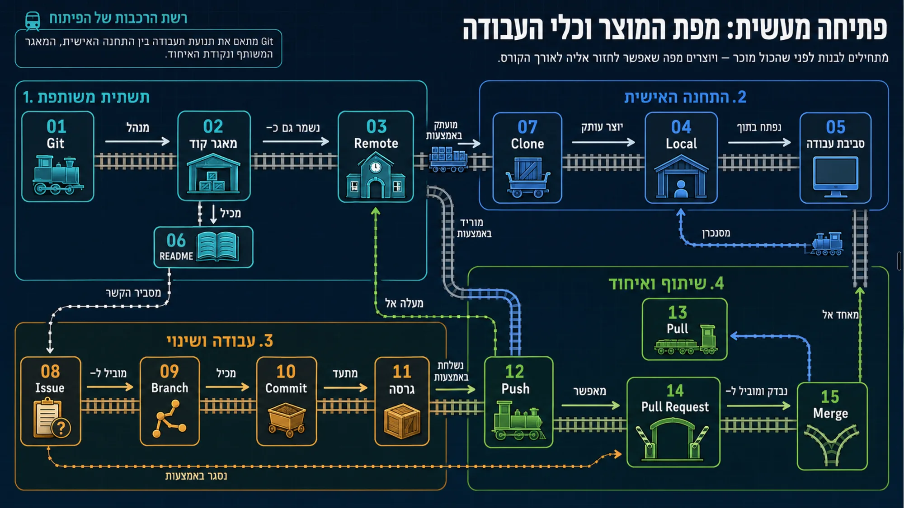

| מושג | ויזואל |
| --- | --- |
| גיט (Git) | 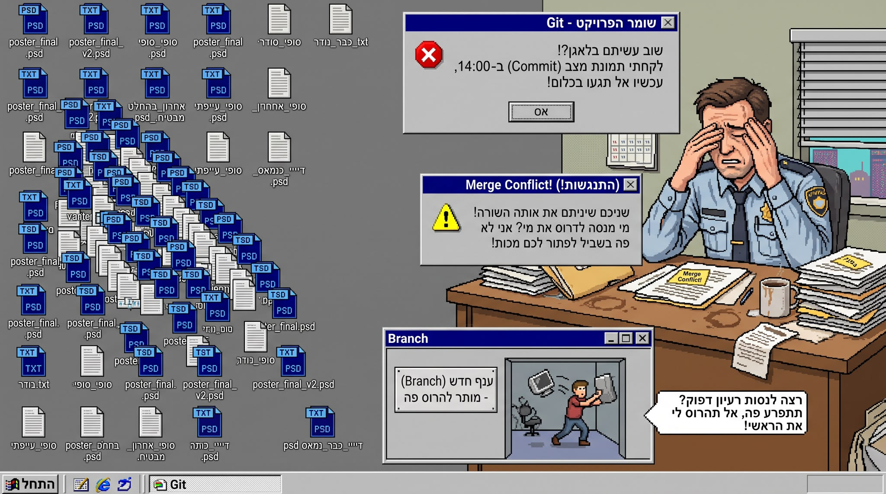 |
| מאגר קוד (Repo) | 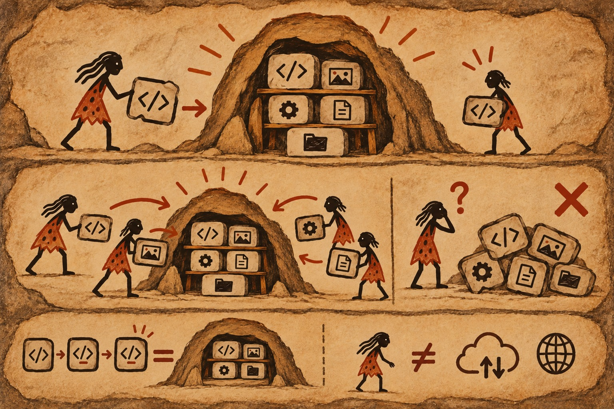 |
| מרוחק (Remote) |  |
| מקומי (Local) | 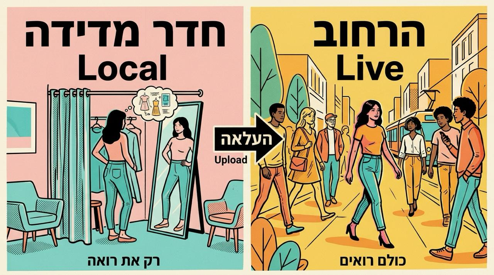 |
| סביבת עבודה (Env) | 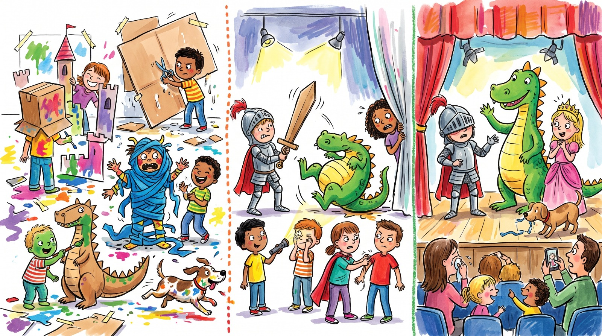 |
| קובץ הסבר (README) | 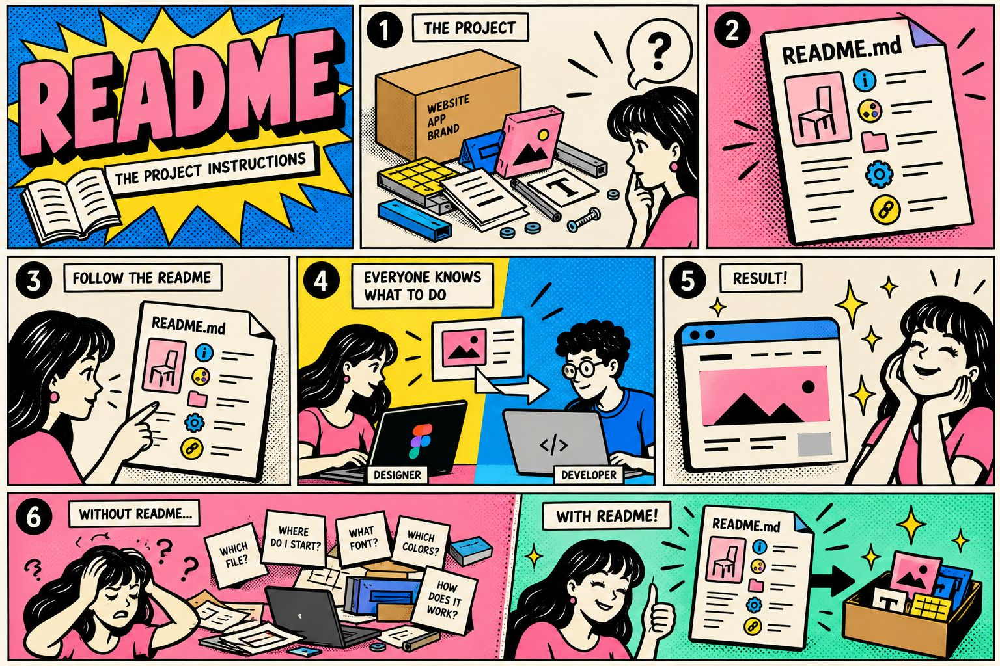 |
| שכפול (Clone) | 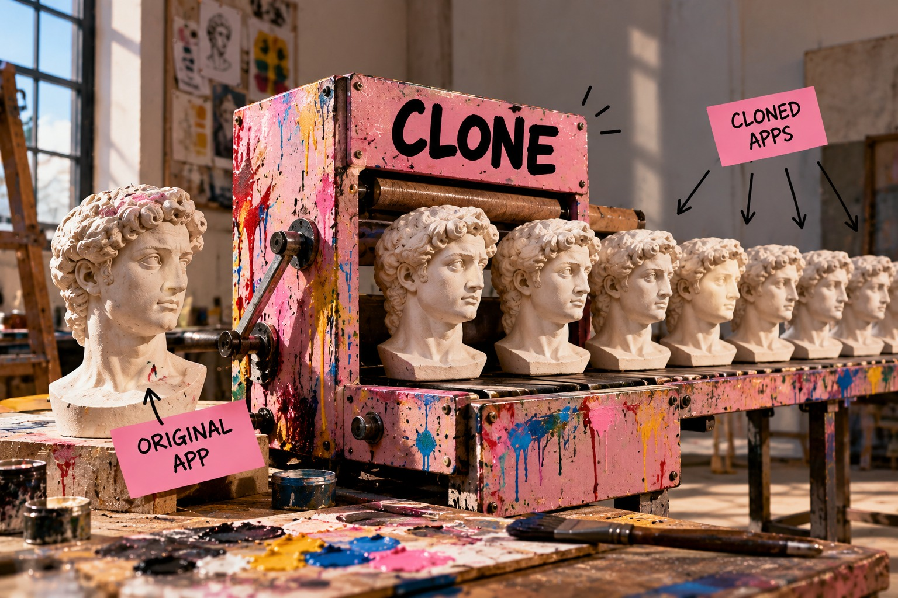 |
| משימה (Issue) | 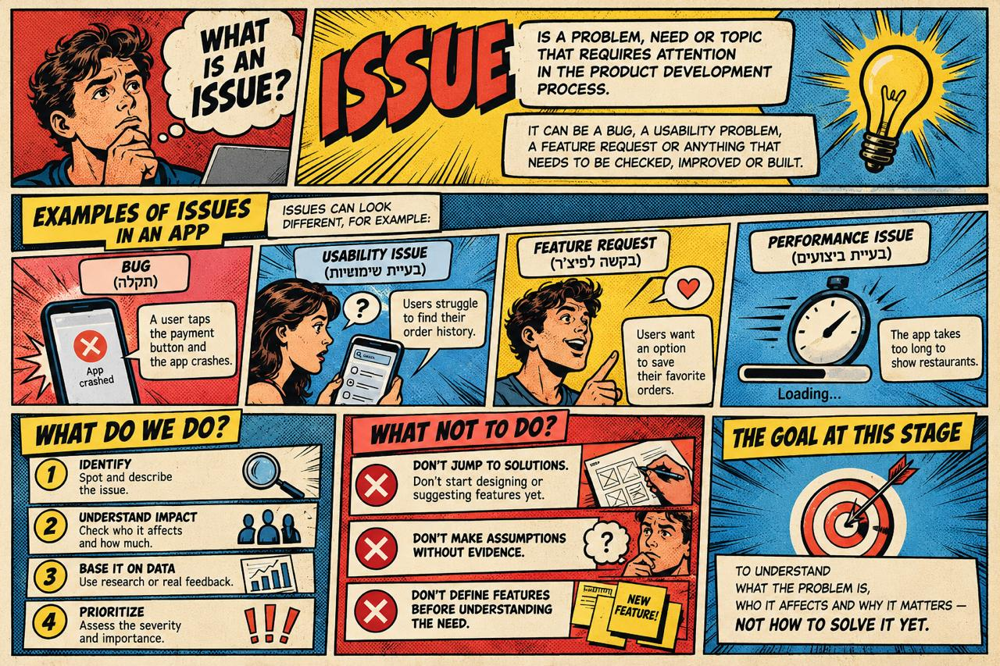 |
| ענף (Branch) | 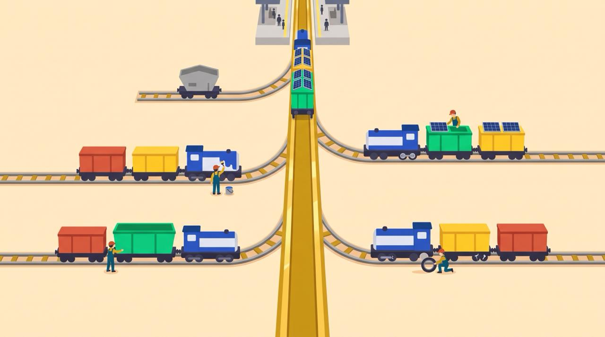 |
| שמירה (Commit) | 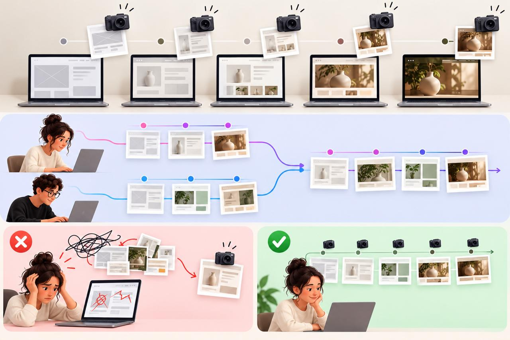 |
| גרסה (Version) | 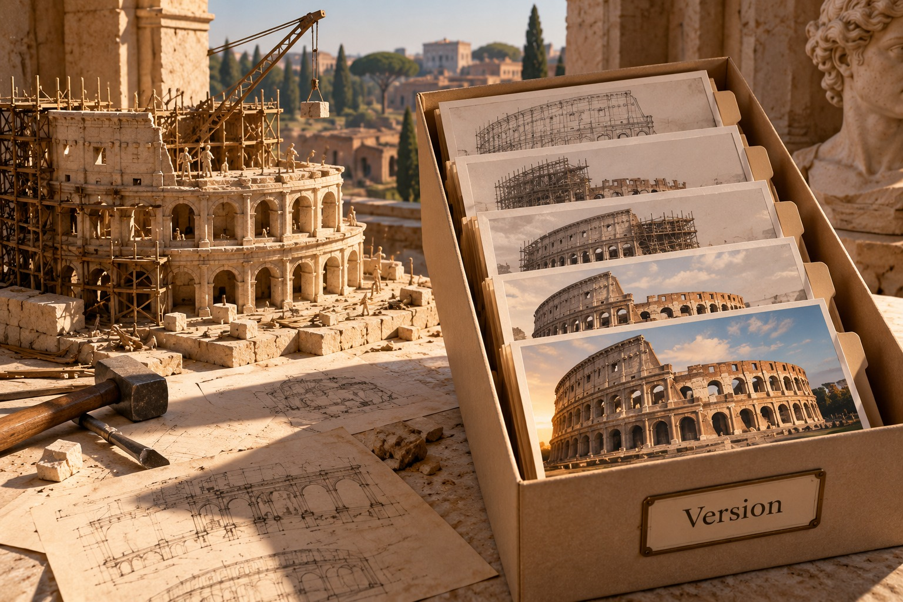 |
| דחיפה (Push) | 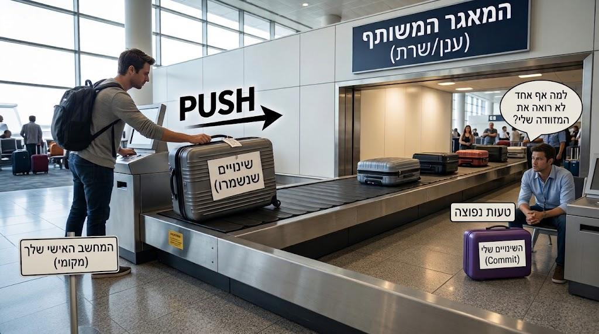 |
| משיכה (Pull) |  |
| בקשת מיזוג (Pull Request) | 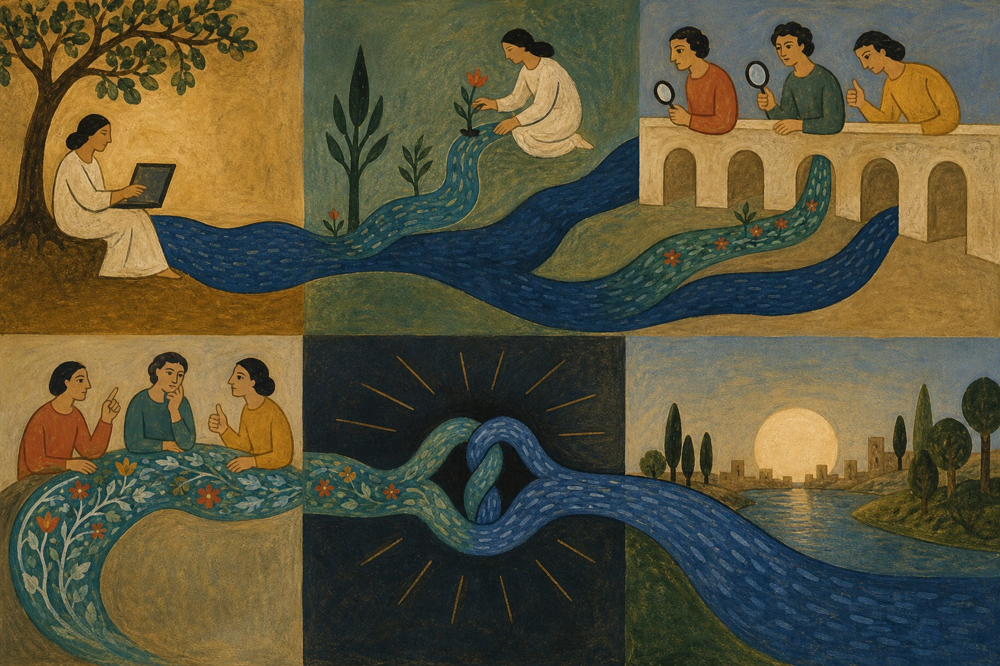 |
| מיזוג (Merge) |  |
